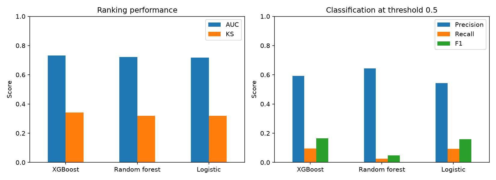

# 信贷违约预测：早期三模型基线对比报告（非最终结果）

> 本目录为早期随机划分实验归档。XGBoost 使用 335 个特征、测试集 160,000 条，AUC 0.7330；不是最终 90 特征、按完整放款月份划分、测试集 79,898 条的模型成绩。最终结果统一见[最终项目报告第 1.2 节](../最终报告/最终项目报告.md#12-最终测试指标与基线对比)：同口径基线 AUC 0.7220、调优模型 AUC 0.7198。不同口径不可直接比较。

配套的[全部指标 CSV](三模型全部指标.csv)和[测试指标 CSV](三模型测试集指标.csv)均为本阶段结果，已附实验阶段、划分方式和划分比例标签；本次仅补充口径说明，未重新训练或修改指标数值。

## 1. 样本与比较口径

三模型使用 data_processing.csv，以 isDefault 为标签，1 为违约、0 为正常。随机种子为 42，按标签分层划分，训练 / 验证 / 测试 = 65% / 15% / 20%。本次测试集均为 **160,000** 条记录，分类阈值均为 **0.5**。

逻辑回归和随机森林使用相同的单行衍生特征；XGBoost 额外使用分组统计交叉特征。本表比较三套现有基线方案，不将结果差异单独归因为算法。

## 2. 模型设置

| 模型 | 特征处理 | 模型设置 |
| --- | --- | --- |
| 逻辑回归 | 单行衍生特征、类别编码、中位数填补、标准化 | L2 正则化，C=1.0，lbfgs，最多 1,000 次迭代 |
| 随机森林 | 单行衍生特征、类别编码、中位数填补 | 100 棵树，最大深度 10，叶节点最少 20 条样本 |
| XGBoost | 单行衍生特征、分组统计交叉特征、类别编码 | 深度 5，学习率 0.05，验证集 AUC 早停 |

## 3. 测试集主要结果

| 模型 | AUC | KS | Precision | Recall | F1 | 样本数 | 特征数 | 阈值 |
| --- | --- | --- | --- | --- | --- | --- | --- | --- |
| XGBoost | 0.733 | 0.341 | 0.5932 | 0.0955 | 0.1645 | 160000 | 335 | 0.5 |
| 随机森林 | 0.7209 | 0.3198 | 0.6436 | 0.0251 | 0.0482 | 160000 | 71 | 0.5 |
| 逻辑回归 | 0.718 | 0.3192 | 0.5435 | 0.0935 | 0.1596 | 160000 | 71 | 0.5 |

按测试集 AUC 排序，**XGBoost** 最高，为 **0.7330**，比第二名高 **0.0121**。固定阈值 0.5 时，Recall 最高的是 **XGBoost**，为 **9.55%**；F1 最高的是 **XGBoost**，为 **0.1645**。

AUC、KS 衡量预测概率的区分表现；Precision 是违约预测中的实际违约比例，Recall 是实际违约样本的识别比例，F1 是两者的调和平均值。

## 4. 三份样本 AUC

| 模型 | 训练集 | 验证集 | 测试集 | 训练-测试差 |
| --- | --- | --- | --- | --- |
| XGBoost | 0.7488 | 0.7343 | 0.733 | 0.0158 |
| 随机森林 | 0.7399 | 0.7219 | 0.7209 | 0.019 |
| 逻辑回归 | 0.7187 | 0.7182 | 0.718 | 0.0007 |

训练-测试差为训练 AUC 减去测试 AUC，表中直接记录样本内外排序表现的差距。

## 5. 指标对比图

## 6. 结果来源

| 模型 | 结果来源 |
| --- | --- |
| 逻辑回归 | 原基线实验运行记录，本次未重算 |
| 随机森林 | 原基线实验运行记录，本次未重算 |
| XGBoost | 历史 CSV 原记载为“XGBOOST.ipynb 已保存输出（四位小数）”；本次保留该记录，未重新验证原实验 |

历史指标读取逻辑见 [code/model/ModelComparison.ipynb](../../code/model/ModelComparison.ipynb)。该 notebook 读取本地结果 CSV，仓库未提供这些运行输入。本地同名 XGBOOST notebook 的历史保存输出为中间阶段 93 特征、测试集 80,000 条的实验，GitHub 版本已清理执行输出；它不是本表 335 特征随机划分结果的直接复现凭证。本表仅保留既有历史指标，不声称仓库可以重新生成该阶段结果，也不能用最终时间划分结果覆盖本表。
