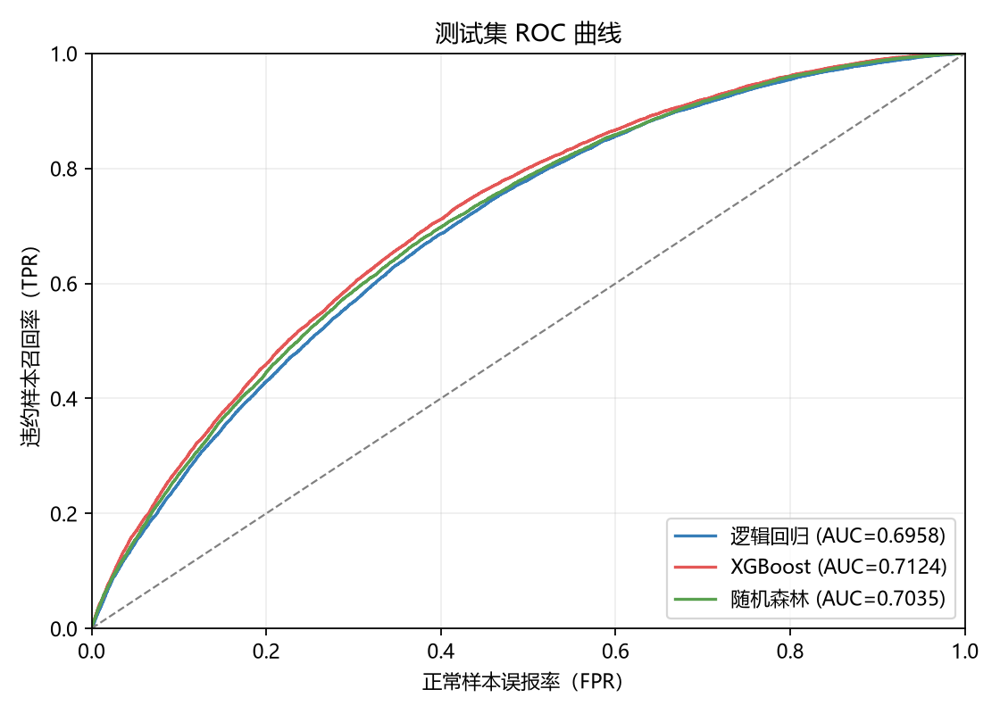
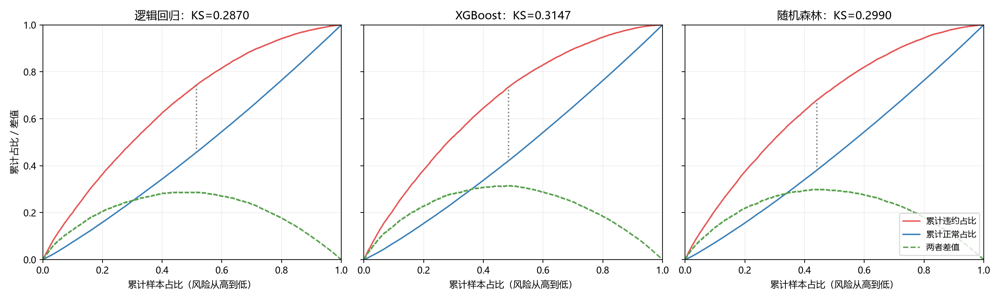
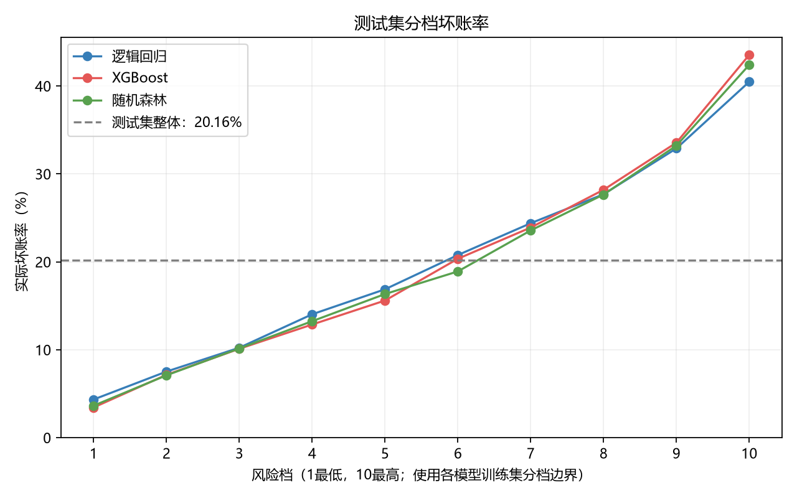

# Model Comparison：逻辑回归、XGBoost 与随机森林

> **中间阶段实验归档，非最终结果。** 本文为按放款年份排序、三模型共用 93 特征、测试集 80,000 条的阶段对比；既不同于 `docs/model/` 的早期随机划分实验，也不同于最终 90 特征、按完整月份划分、测试集 79,898 条的评估。最终成绩统一见[最终项目报告](../最终报告/最终项目报告.md)，不得跨口径拼接指标。

## 1. 实验设置

### 数据与划分

三个模型共用同一批 93 个特征，包括原始数值、业务衍生和分组统计等特征。

样本按放款年份排序，再按 70% / 20% / 10% 划分训练、验证和测试集

| 样本   |  样本数 | 占比 | 违约率 |
| ------ | ------: | ---: | -----: |
| 训练集 | 560,000 |  70% | 19.01% |
| 验证集 | 160,000 |  20% | 23.14% |
| 测试集 |  80,000 |  10% | 20.16% |
| 合计   | 800,000 | 100% | 19.95% |

### 模型与参数

LogitRegression，默认优化器，C=1.0，最多迭代1,000次。只训练一次，不搜索参数。

XGBoost 最多训练 1,000 轮，验证集 AUC 连续 50 轮没有提升就停止，本次最佳轮次为356。

随机森林最多100棵树，最深10层，最小叶子节点的样本不少于20个样本。

| 模型     | 特征处理                             | 主要参数                                                                                            |
| -------- | ------------------------------------ | --------------------------------------------------------------------------------------------------- |
| 逻辑回归 | 用训练集的中位数填补缺失，再标准化   | L2 正则，C=1.0，solver=lbfgs，max_iter=1000                                                         |
| XGBoost  | 直接使用保存的特征，由模型处理缺失值 | max_depth=5，min_child_weight=5，学习率=0.05，subsample=0.8，colsample_bytree=0.8，tree_method=hist |
| 随机森林 | 用训练集的中位数填补缺失，不标准化   | n_estimators=100，max_depth=10，min_samples_leaf=20                                                 |

## 2. 指标汇总表

| 模型              |         训练 AUC |         验证 AUC |         测试 AUC |          测试 KS |  PSI：训练→验证 |  PSI：训练→测试 |
| ----------------- | ---------------: | ---------------: | ---------------: | ---------------: | ---------------: | ---------------: |
| 逻辑回归          |           0.7164 |           0.7064 |           0.6958 |           0.2870 |           0.0073 |           0.0034 |
| **XGBoost** | **0.7378** | **0.7158** | **0.7124** | **0.3147** | **0.0058** | **0.0031** |
| 随机森林          |           0.7282 |           0.7071 |           0.7035 |           0.2990 |           0.0071 |           0.0077 |

- **AUC** 看整体风险排序能力，越高越好；
- **KS** 看正常与违约样本能拉开多大差距，也是越高越好；
- **PSI** 看预测概率分布有没有变化，越小表示分布越接近。
  - 这里以各模型训练集预测概率的十分位点固定分档，再比较验证、测试集的各档占比；零占比用 0.000001 兜底。
- XGBoost 在验证集和测试集的 AUC 都最高。测试 AUC 比随机森林高 **0.0090**，比逻辑回归高 **0.0166**；测试 KS 也最高。

## 3. 图表：ROC、KS 曲线、分档坏账

以下图表均基于同一份 80,000 条测试样本。

### 3.1 ROC 曲线

曲线越靠左上角越好，表示在相同误报率下能识别更多违约客户。

XGBoost 的整体排序表现最好，随机森林其次，逻辑回归略低。

### 3.2 KS 曲线

横轴按预测风险从高到低累计样本。红、蓝线分别是已覆盖违约样本、正常样本占各自总数的比例，两条线的最大差值就是 KS。

XGBoost 的 KS 为 **0.3147**，区分度最好。

### 3.3 分档坏账率

各模型按自己的训练集预测概率切成 10 档，再把同样的分档边界用于测试集。第 1 档风险最低，第 10 档最高；测试集每档人数不一定相等，不同模型同一档也不一定是同一批客户。

| 模型     | 最低风险档坏账率 | 最高风险档坏账率 | 最高风险档样本数 |
| -------- | ---------------: | ---------------: | ---------------: |
| 逻辑回归 |            4.34% |           40.48% |            7,796 |
| XGBoost  |            3.44% |           43.54% |            7,783 |
| 随机森林 |            3.64% |           42.41% |            7,704 |

三个模型的坏账率都随风险档上升，说明都能做出风险分层。XGBoost 的最低档坏账率更低、最高档更高，高低风险客户分得更开。

测试集整体坏账率为 **20.16%**，可作为图中的参考线。

## 4. 选型结论

XGBoost 在验证集 AUC、测试集 AUC 和测试 KS 上都领先，分档坏账率也支持这个结论，适合继续做风险排序和阈值优化。

| 模型     | 优点                                            | 不足                         |
| -------- | ----------------------------------------------- | ---------------------------- |
| XGBoost  | 能学习非线性和交互，本次 AUC、KS 和风险分层最好 | 参数和解释更复杂，可能过拟合 |
| 逻辑回归 | 系数方向容易说明                                | 分度低                       |
| 随机森林 | 处理非线性                                      | 预测和解释成本高             |
