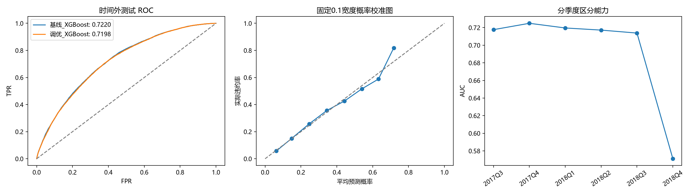
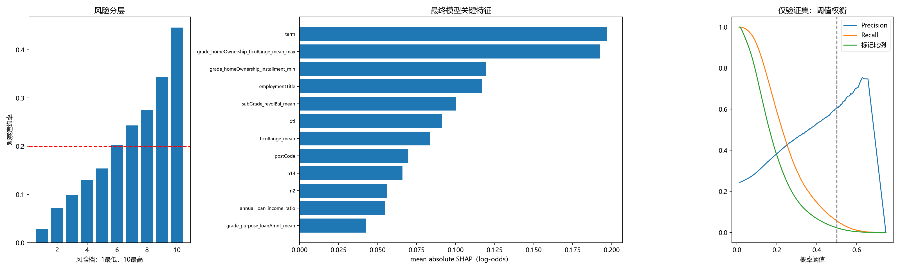

# 实验报告

报告日期：2026-11-11。

标签定义：isDefault=1 为违约、0 为正常。最终交付模型为 调优_XGBoost，保留 90 个特征。

## 1. 测试集最终评估与模型泛化能力分析

### 1.1 项目流程

项目首先完成业务理解、字段核对、探索分析与清洗，再开展偿债能力、账户结构、信用水平及匿名行为聚合特征构造；

随后比较逻辑回归、随机森林与 XGBoost 的早期方案，最终进入 XGBoost 的按月时间验证与参数优化。早期三模型报告采用随机划分，后使用时间序列划分。

本项目围绕一个业务问题展开：面对持续进入的贷款客户，如何利用已有申请与信用信息识别高风险客户，并在控制拒绝规模的同时，尽量降低通过客户的观察违约率。主要实验思路如下：

| 实验环节                         | S：问题场景                                                                    | T：实验目标                                                   | A：具体行动                                                                        | R：结果及业务判断                                                                                   |
| -------------------------------- | ------------------------------------------------------------------------------ | ------------------------------------------------------------- | ---------------------------------------------------------------------------------- | --------------------------------------------------------------------------------------------------- |
| 从随机评估转向时间评估           | 实际使用时，需要用历史贷款预测后续月份；早期随机划分不足以单独回答这一问题     | 检查模型在后续放款时期的风险区分能力                          | 按完整月份切分样本，在训练期采用扩展窗口验证，并将特征处理限制在对应训练窗口内     | 测试 AUC 为 0.7198、KS 为 0.3263，形成历史时间外评价                                                |
| 特征构造与参数优化               | 原始字段未必充分表达偿债压力、账户结构和变量交互，增加复杂度也未必带来稳定收益 | 在统一评价口径下，检验优化方案相对基线的增量价值              | 构造业务及聚合特征、进行筛选，完成 20 次参数搜索，再按验证期表现选型               | 验证 AUC 为 0.7012，但测试 AUC 未超过同口径基线 0.7220；优化过程形成了候选模型，未证明稳定优于基线  |
| **从默认阈值转向容量约束** | **0.5 阈值只覆盖少量高分客户，难以兼顾违约捕获与客户保留**               | **在验证集拒绝率不超过 30% 的前提下，最小化通过组坏率** | **枚举验证集阈值，先筛选容量可行解，再按通过组坏率排序，锁定后应用于测试期** | **阈值为 0.2275；测试拒绝率为 34.63%、通过组坏率为 12.40%，须分别判断容量迁移和风险保留效果** |
| 从模型分数转向业务解释           | 风险分数本身不能说明应核查哪些信息，也不能证明干预有效                         | 判断评分能否支持复核排序，并明确解释边界                      | 结合风险十分档、TreeSHAP、季度指标和字段漂移分析                                   | 最高风险档违约率为 44.61%，Lift 为 2.24；可提出分层复核方案，但尚未验证真实降损收益                 |

最终流程按 issueDate、id 排序，以完整月份切分；缺失处理、分组统计、标签熵、编码、IV 和共线性筛选均在相应训练窗口内拟合。训练期内采用 5 折扩展窗口交叉验证，使用 Optuna TPE 完成 20 次参数搜索；在独立验证期按 AUC、KS 确定模型名称，再合并训练及验证样本重新拟合特征处理器和两套 XGBoost，最后评估测试期。测试结果不用于改选模型或搜索参数。第 1 节保留既有 0.5 阈值作为分类表现对照，第 2 节报告业务约束下的阈值选择及应用结果；两者用于回答不同问题，不混用指标。

| 样本   | 样本数 | 违约率 | 开始日期   | 结束日期   |
| ------ | ------ | ------ | ---------- | ---------- |
| 训练集 | 558371 | 18.65% | 2007-06-01 | 2016-03-01 |
| 验证集 | 161731 | 24.45% | 2016-04-01 | 2017-06-01 |
| 测试集 | 79898  | 19.93% | 2017-07-01 | 2018-12-01 |

原始数据共 800,000 条。此次从原始 CSV 重新执行工龄、日期及异常 DTI 清洗，并逐字段核对 data_processing.csv，检查见 cleaning_replay_audit.csv。测试集包含 79,898 条记录，其中正常 63,972 条、违约 15,926 条。重新加载最终模型后，对全部测试样本的两套模型预测均与已保存概率核验一致，见 prediction_replay_audit.csv。上述核对验证了流程一致性，但不等同于原始标签真实性审计。

### 1.2 最终测试指标与基线对比

| 模型         | AUC    | KS     | PR-AUC | Precision | Recall | F1     | 标记比例 | Brier  |
| ------------ | ------ | ------ | ------ | --------- | ------ | ------ | -------- | ------ |
| 基线_XGBoost | 0.7220 | 0.3270 | 0.3793 | 0.5093    | 0.0966 | 0.1624 | 0.0378   | 0.1439 |
| 调优_XGBoost | 0.7198 | 0.3263 | 0.3756 | 0.5304    | 0.0669 | 0.1188 | 0.0251   | 0.1440 |

最终模型 AUC 为 0.7198，KS 为 0.3263，说明在这一历史时间外样本中存在一定的违约风险区分能力。PR-AUC 按 average precision 定义，为 0.3756，约为测试集违约率 19.93% 这一随机排序参考的 1.88 倍。

从业务角度看，排序能力对应的是“能否把更多潜在违约客户排在复核队列前列”，而不是“每笔贷款能否被准确判定”**。因此，AUC、KS 用于判断分数是否有排序价值；真正决定复核工作量、正常客户误拒和剩余组合风险的，还包括具体阈值、拒绝比例、Precision 与通过组坏率。**不能仅凭 AUC 较高，就得出应自动拒绝某个客户的结论。

调优模型验证集 AUC 为 0.7012，高于同口径基线的 0.6972；但测试 AUC 比基线 0.7220 **低 0.0022**，KS、PR-AUC 也未超过基线。因此，验证期择优的模型在测试期具有排序信息，但未在最终测试中稳定优于基线。

**这一结果对模型迭代的启示是：特征更多、调参更充分，不等于业务方案更优。后续比较应在同样的拒绝比例下，检查通过组坏率、违约捕获及实施成本，而不是只展示调优模型的单项最高分。**

### 1.3 固定 0.5 阈值下的分类表现

| 实际类别 | 预测正常 | 预测违约 |
| -------- | -------- | -------- |
| 正常     | 63029    | 943      |
| 违约     | 14861    | 1065     |

指标：0.5 阈值共标记 2,008 条贷款，占测试集 2.51%；其中 1,065 条实际违约，Precision 为 53.04%。但是 Recall 仅为 6.69%，仍有 14,861 条违约没有被标记，漏判比例为 93.31%。

判断：“被标记客户中违约较集中”不代表“识别出大部分违约”：当前阈值偏向少量、高分标记，不适合直接承担广覆盖违约预警。

若业务目标是广覆盖预警，这种低 Recall 意味着大量后续违约客户没有进入高风险名单；若目标只是挑出少量重点核查对象，则还要考察名单命中率与可用人力是否匹配。两种场景不能用同一个“准确率较高”来证明成功。为此，本项目将改动重点从机械采用 0.5，转向第 2.3 节的容量约束阈值搜索。

### 1.4 时间稳定性与统计不确定性

| 模型         | CV平均AUC | CV标准差 |
| ------------ | --------- | -------- |
| 基线_XGBoost | 0.6321    | 0.0505   |
| 调优_XGBoost | 0.6669    | 0.0467   |

调优模型各时间折 AUC 从 0.6149 到 0.7339，最早一折训练样本只有 1,369 条，最新一折为 249,234 条。各折样本规模、时间和保留特征均不同，CV 标准差不是最终测试 AUC 的置信区间，早期表现受小样本与时期差异共同影响。测试 AUC 高于验证 AUC 也不能证明“没有过拟合”，因为最终模型已用更多样本再训练，而两个时期的违约率和客户结构也不同。本次不使用开发集 transform 后的样本内 AUC 来夸大泛化能力。

| 季度   | 样本数     | 违约率 | AUC    | KS     | PR-AUC |
| ------ | ---------- | ------ | ------ | ------ | ------ |
| 2017Q3 | 26133.0000 | 0.2421 | 0.7177 | 0.3177 | 0.4334 |
| 2017Q4 | 20350.0000 | 0.2131 | 0.7249 | 0.3383 | 0.4027 |
| 2018Q1 | 13399.0000 | 0.1957 | 0.7196 | 0.3299 | 0.3699 |
| 2018Q2 | 10971.0000 | 0.1790 | 0.7172 | 0.3335 | 0.3368 |
| 2018Q3 | 6085.0000  | 0.0988 | 0.7138 | 0.3438 | 0.2030 |
| 2018Q4 | 2960.0000  | 0.0260 | 0.5711 | 0.1648 | 0.0455 |

**最近季度需要单独关注。** 2018Q4 仅 2,960 笔贷款、77 笔违约，观察违约率为 2.60%，AUC 为 **0.5711**；不能用全测试期的均值掩盖末期表现。同期样本数量与坏账率下降，可能涉及客户结构变化、标签成熟度或其他样本机制，但现有文件不足以确定原因。需优先核对标签观察终点与成熟窗口，再在新增、同口径成熟样本上复验，不能先验地将其解释成模型改善或经济环境变好。

针对固定模型实施 300 次配对 bootstrap，同一轮对两套模型使用相同样本权重；另采用整月分块重采样，粗略考虑同月记录的相关性。以下为百分位 95% 区间，不包含重新训练、特征选择和调参全过程的不确定性。

| 方法                  | 指标          | 点估计  | 95%下限 | 95%上限 |
| --------------------- | ------------- | ------- | ------- | ------- |
| 逐笔配对bootstrap     | 最终模型AUC   | 0.7198  | 0.7153  | 0.7240  |
| 逐笔配对bootstrap     | 最终减基线AUC | -0.0022 | -0.0036 | -0.0007 |
| 整月分块配对bootstrap | 最终模型AUC   | 0.7198  | 0.7141  | 0.7239  |
| 整月分块配对bootstrap | 最终减基线AUC | -0.0022 | -0.0040 | -0.0011 |

整月分块重采样的模型差值区间整体为负，在该重采样假设下支持调优模型略低于基线；不能据此声称其具有泛化优势。 整月方法仅使用测试期 18 个月，仍不能充分处理月间依赖，也不支持外推至其他机构或宏观周期。

业务上应将季度评价视为策略监测，而非报告附表：整体指标尚可，不代表每个放款批次都适合沿用相同规则。若后续出现风险排序下降、拒绝比例超限或通过组坏率恶化，应先核对标签成熟度、客群及字段采集变化，再决定是否需要重新校准或调整模型。低观察违约率只有在观察期限与标签口径可比时，才具有风险改善的解释基础。

### 1.5 概率校准与分布变化

最终模型 Brier 为 0.1440、LogLoss 为 0.4495；固定 0.1 宽度概率分箱的加权绝对校准误差为 0.0076。测试集平均预测概率为 19.75%，实际违约率为 19.93%。这些值与分箱图共同描述概率质量，但不能仅凭平均接近或单个分数断言校准充分，高概率尾部还需关注样本稀疏问题。当前未执行独立样本上的概率校准，不能把排序能力自动转化为可靠的预期损失估计。

开发集与测试集原始字段的 PSI 如下。数值型字段以开发集分位点定义边界，缺失单列一箱，计数加 0.5 平滑；不使用测试标签分箱。PSI 只描述分布差异，不构成概念漂移或模型失效的因果检验，不机械套用统一告警线。

| 字段         | PSI    | 开发集缺失率 | 测试集缺失率 |
| ------------ | ------ | ------------ | ------------ |
| n14          | 0.5269 | 0.0559       | 0.0000       |
| revolUtil    | 0.2048 | 0.0006       | 0.0013       |
| ficoRangeLow | 0.0766 | 0.0000       | 0.0000       |
| subGrade     | 0.0452 | 0.0000       | 0.0000       |
| dti          | 0.0288 | 0.0001       | 0.0025       |
| grade        | 0.0145 | 0.0000       | 0.0000       |
| annualIncome | 0.0041 | 0.0000       | 0.0000       |
| term         | 0.0028 | 0.0000       | 0.0000       |

当前 n14 的 PSI 为 0.5269，缺失率由开发期 5.59% 降至测试期 0.00%；revolUtil 的 PSI 为 0.2048。概率质量与业务用途也需要区分。用于人工复核时，首先关注高分客户是否更集中地包含违约；若进一步用于额度、定价或预期损失测算，则需要可信的绝对风险概率，以及额度、回收和观察期限等信息。字段分布变化应落实为具体排查事项，例如核对 n14 的缺失变化是否来自采集流程或人群变化，而不是直接将 PSI 数值转化为拒贷理由。

## 2. 业务解读

### 2.1 关键特征及业务含义

本次重新解释最终 90 特征模型，而非沿用早期模型的重要性图。对开发集固定随机抽样 2,000 条记录，直接计算 XGBoost 原生 TreeSHAP，并验证贡献加总经 sigmoid 后与模型概率一致。下表按平均绝对 SHAP 排名，单位为 log-odds；它表示模型依赖程度，不是违约概率变化的百分点，更不是因果效应。该解释样本来自模型开发期，结论也受相关特征与样本分布影响。

| 特征                                   | 平均绝对SHAP | SHAP占比 |
| -------------------------------------- | ------------ | -------- |
| term                                   | 0.1971       | 0.1117   |
| grade_homeOwnership_ficoRange_mean_max | 0.1924       | 0.1090   |
| grade_homeOwnership_installment_min    | 0.1197       | 0.0678   |
| employmentTitle                        | 0.1167       | 0.0661   |
| subGrade_revolBal_mean                 | 0.1003       | 0.0568   |
| dti                                    | 0.0912       | 0.0517   |
| ficoRange_mean                         | 0.0837       | 0.0474   |
| postCode                               | 0.0697       | 0.0395   |
| n14                                    | 0.0659       | 0.0373   |
| n2                                     | 0.0561       | 0.0318   |
| annual_loan_income_ratio               | 0.0550       | 0.0312   |
| grade_purpose_loanAmnt_mean            | 0.0427       | 0.0242   |

| 分组                   | SHAP占比 |
| ---------------------- | -------- |
| 既有评级及其交叉统计   | 0.4315   |
| 职业标题地区及交叉统计 | 0.2172   |
| 借款合同与偿债安排     | 0.1620   |
| 匿名行为特征           | 0.0713   |
| 其他财务与征信特征     | 0.0707   |
| FICO信用水平           | 0.0474   |

既有评级及其交叉统计约占绝对 SHAP 总量的 **43.15%**。grade、subGrade 与余额、收入、月供等的历史分组统计，可能同时承载原评级体系的信息和群体结构差异。强依赖评级意味着模型可能主要在既有评分基础上进行再排序，需要通过去评级消融评估独立增量价值。

以下相关系数只描述抽样开发记录中“特征取值—本特征 SHAP”的总体关联，允许存在非线性及交互，不能当成全局单调关系或借款人可干预后的效果。

| 特征                    | 取值与SHAP的Spearman相关 | 解释样本数 |
| ----------------------- | ------------------------ | ---------- |
| term                    | 0.7574                   | 2000.0000  |
| ficoRange_mean          | -0.9655                  | 2000.0000  |
| dti                     | 0.9671                   | 2000.0000  |
| n14                     | 0.9697                   | 2000.0000  |
| anonymous_nonzero_count | 0.3735                   | 2000.0000  |
| annualIncome            | -0.8219                  | 2000.0000  |

在本次抽样中，term、dti 与各自 SHAP 贡献呈正向总体关联，FICO 均值、年收入呈负向总体关联，与“较长期限、较高偿债压力对应更高模型风险，较好信用水平与较高收入对应更低模型风险”的业务解释基本一致。但职业与邮编是编码变量，不能把其数值大小当作业务等级；匿名 n14 的正相关也不允许反推未公开的行为定义。上述方向只是关联性解释，不作因果推断或独立拒贷依据。

这些结果可以转化为复核线索，而不是直接转化为处置结论。例如，对偿债负担相关信息突出的高风险客户，可核验收入、现有负债与申请信息是否一致；对长期限贷款，可单独检查同期限客户的排序和标签成熟度；对评级交叉特征占比较高的情况，应检验模型相对于既有评级究竟补充了多少信息。上述均是待验证的业务应用建议，本次未测试“调整期限、降低额度或加强核查”是否能降低同一客户的违约概率。

### 2.2 风险分层及复核应用

| 风险档  | 样本数    | 违约率 | 平均预测概率 | 累计违约捕获率 | Lift   |
| ------- | --------- | ------ | ------------ | -------------- | ------ |
| 10.0000 | 7990.0000 | 0.4461 | 0.4580       | 0.2238         | 2.2378 |
| 9.0000  | 7990.0000 | 0.3431 | 0.3312       | 0.3959         | 1.7210 |
| 8.0000  | 7990.0000 | 0.2757 | 0.2703       | 0.5342         | 1.3832 |
| 7.0000  | 7989.0000 | 0.2432 | 0.2263       | 0.6562         | 1.2201 |
| 6.0000  | 7990.0000 | 0.2025 | 0.1899       | 0.7578         | 1.0159 |
| 5.0000  | 7990.0000 | 0.1537 | 0.1579       | 0.8349         | 0.7710 |
| 4.0000  | 7989.0000 | 0.1297 | 0.1288       | 0.9000         | 0.6506 |
| 3.0000  | 7990.0000 | 0.0987 | 0.1012       | 0.9495         | 0.4954 |
| 2.0000  | 7990.0000 | 0.0725 | 0.0725       | 0.9859         | 0.3635 |
| 1.0000  | 7990.0000 | 0.0282 | 0.0391       | 1.0000         | 0.1413 |

测试期最高风险 10% 客户的违约率为 44.61%，最低风险 10% 为 2.82%。最高档 Lift 为 2.24，覆盖约 10.00% 客户，捕获 22.38% 的全部违约。十分档由预测分数确定，属于风险排序评价，不是用测试标签优化阈值。可据此设计高分客户优先核验或贷后关注，但不能从历史集中度直接推算真实降损金额。

这一结果支持的业务解释是“有限核查资源优先投向高风险队列”，而不是“最高风险档客户都会违约”。即便高风险档违约较集中，仍包含未违约客户；低风险档也不是无风险客户。可将以下分层流程作为后续影子试运行方案，不视为已经部署或证明有效的规则。

| 使用场景         | 建议流程                                                                     | 需要观察的业务结果                                                   |
| ---------------- | ---------------------------------------------------------------------------- | -------------------------------------------------------------------- |
| 贷前高风险复核   | 对高分客户优先核验关键申请材料，保留人工判断，不仅凭模型分数自动拒绝         | 复核命中率、正常客户误拒、处理时长及申请流失；拒绝量与复核量分别记录 |
| 一般风险客户处理 | 结合既有授信政策和资料完整性处理，不把未进入高风险队列解释为无违约风险       | 通过组坏率、业务通过规模及后续风险变化                               |
| 贷后分层关注     | 将评分作为历史风险分层参考，结合后续还款信息安排关注；本次未建立动态贷后模型 | 同账龄逾期、实际回收和管理成本，不能只用分数高低评价干预效果         |

### 2.3 风险阈值选择：技术候选与业务约束

原模型的 0.5 是技术默认，并非经营最优值。

**业务确认的硬约束为验证集拒绝率不超过 30%，优化目标为最小化通过组坏率、。仅用验证期概率和标签筛选满足拒绝率约束的阈值，选择通过组坏率最低者；若相同，优先选择拒绝率更低、阈值更高者。无可行阈值时停止应用，不自动放宽拒绝率约束或回退到 0.5。最大 KS、最大 F1、Recall 至少 60% 和容量 20% 仍只作为对照候选，不使用测试标签寻找“最优阈值”。**

拒绝率为被阈值划入拒绝组的样本数占全部样本的比例；通过组坏率为通过组违约样本数除以通过组样本数。以 100 笔申请作为容量示意，30% 的拒绝率上限表示最多划出 30 笔，并非保证剩余客户不会违约。在默认阈值捕获不足、同时不能无限扩大拒绝规模的前提下，为了改善通过组合的风险构成，把“通过组坏率最小”作为排序目标，将拒绝率作为先决约束，最终应用阈值为 0.2275，测试期 Recall 为 59.34%、拒绝率为 34.63%、通过组坏率为 12.40%。

**业务验收应按“容量—风险—客户影响”顺序解读**：先检查测试拒绝率是否超过约定上限；再将通过组坏率 12.40% 与同一测试总体违约率 19.93% 对照，判断离线分组是否保留了风险更低的组合；最后结合 Precision 和被拒正常客户规模，评估为此付出的客户机会成本。即使通过组坏率下降，也只说明历史样本被重新筛选，不能证明客户本身的风险降低或机构净收益增加。若固定阈值跨期导致拒绝量超限，应将其记为容量迁移未达标，不能用风险改善抵消；严格批次限额的排名分配需要另行设计和验证，不能宣称当前代码已经实现。

| 策略                      | 集合             | 阈值             | Precision        | Recall           | 标记比例         | 通过组违约率     | F1               |
| ------------------------- | ---------------- | ---------------- | ---------------- | ---------------- | ---------------- | ---------------- | ---------------- |
| 原固定阈值                | 验证集           | 0.5000           | 0.6050           | 0.0569           | 0.0230           | 0.2360           | 0.1039           |
| 原固定阈值                | 测试集           | 0.5000           | 0.5304           | 0.0669           | 0.0251           | 0.1908           | 0.1188           |
| **验证集最大KS**    | **验证集** | **0.1675** | **0.3558** | **0.7033** | **0.4832** | **0.1404** | **0.4726** |
| 验证集最大KS              | 测试集           | 0.1675           | 0.2974           | 0.7734           | 0.5183           | 0.0938           | 0.4297           |
| 验证集最大F1              | 验证集           | 0.1644           | 0.3529           | 0.7150           | 0.4954           | 0.1381           | 0.4726           |
| 验证集最大F1              | 测试集           | 0.1644           | 0.2944           | 0.7804           | 0.5284           | 0.0928           | 0.4275           |
| 召回至少60%示例           | 验证集           | 0.1968           | 0.3808           | 0.6000           | 0.3853           | 0.1591           | 0.4659           |
| 召回至少60%示例           | 测试集           | 0.1968           | 0.3198           | 0.6878           | 0.4287           | 0.1089           | 0.4366           |
| **复核容量20%示例** | **验证集** | **0.2743** | **0.4429** | **0.3623** | **0.2000** | **0.1949** | **0.3985** |
| 复核容量20%示例           | 测试集           | 0.2743           | 0.3754           | 0.4532           | 0.2407           | 0.1435           | 0.4106           |
| 业务约束阈值              | 验证集           | 0.2275           | 0.4070           | 0.4992           | 0.2999           | 0.1749           | 0.4484           |
| 业务约束阈值              | 测试集           | 0.2275           | 0.3415           | 0.5934           | 0.3463           | 0.1240           | 0.4335           |

以验证集最大 KS 对应的 0.1675 为观察性候选，测试期 Recall 为 77.34%、Precision 为 29.74%、标记比例为 51.83%、通过组观察违约率为 9.38%。这个候选需要标记超过一半的测试客户，并不适合产能有限的人工逐笔复核。最大 KS 追求两类区分差距，而非复核规模、经营利润或审批通过率的最优解，不能仅因召回更高就直接推荐上线。

若复核产能设为约 20%，验证期容量受限候选阈值为 0.2743，迁移到测试期后标记比例为 24.07%、Recall 为 45.32%、Precision 为 37.54%，说明固定概率阈值不保证跨时期容量不超标。若实际流程强调严格每日或每月处理量，可研究预先约定的评分 Top-K/分位排名队列，并在新样本上验收风险覆盖和业务效果；不能在当前测试标签上反复调整 K。

本项目已形成从原始清洗、探索与特征构造，到时间切分、调参、模型保存、时间外评价和业务解释的可复现链路。最终模型测试 AUC 为 0.7198、KS 为 0.3263，风险分层对人工复核排序具有参考价值；但没有稳定超过同口径基线，默认阈值 Recall 只有 6.69%。

## 3. 反思与经验

### 3.1 局限性反思

- 目标泄露问题：不清楚grade subgrad的评级时间点，本次将其纳入特征可能高估模型效力
- 模型搜索：搜索只有 20 次试验，早期折样本少；IV、相关性、VIF 多轮筛选可能不稳定，也可能删掉树模型有用的交互。
- 阈值及校准边界：无真实业务约束，本次项目仅明确容量约束和风险目标，仍缺少成本、收益及跨期稳定性证据，无法确定经营最优阈值。

### 3.2 经验沉淀

本次项目的主要经验是，模型评价应从固定规则转向业务目标。

阈值最初采用0.5，后改为在验证集上比较最大KS、最大F1、召回率要求和复核容量四类方案，分别考察风险区分、识别均衡、违约覆盖与资源约束。最终以拒绝率不超过30%为约束，选择通过组坏率最低的阈值，锁定后用于测试集，避免根据测试结果反复调整。

其次，使用bootstrap评价AUC及模型差值的不确定性。weighted-AUC以样本被抽中的次数作为权重，等价于在重复抽样后的样本上计算AUC，无需实际复制数据；它衡量违约客户得分高于正常客户的加权比例，同分按一半计入。某轮若缺少任一类别，AUC便无法定义，因此跳过该轮并记录有效次数，而不是填零。逐笔配对抽样以客户记录为单位，两模型共享同一组抽样权重，使差值比较保留配对关系；整月分块配对则抽取月份并保留月内全部记录，考虑同月客户共同受到环境冲击的相关性。

最后，特征漂移不能只停留在指标告警。后续可围绕循环额度利用率revolUtil，结合时间序列检查漂移发生的时点，对照市场环境、政策事件及客群结构变化，同时核查缺失、异常值和统计口径，再观察其与违约关系是否改变。这部分原因排查尚未在代码中执行，应作为后续分析方案。
