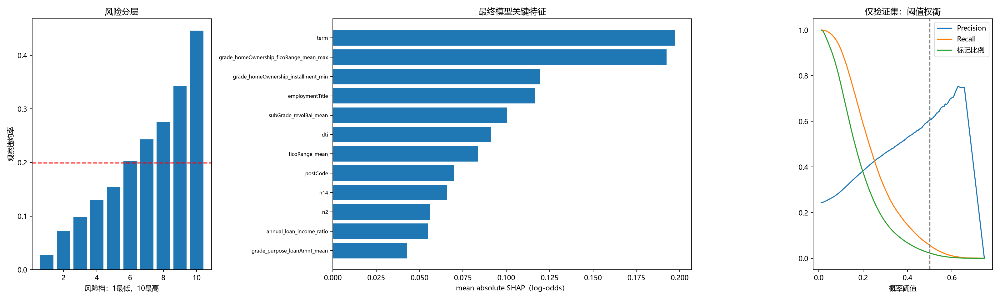

# 信贷风险模型汇报

汇报日期：2026-11-11｜交付模型：调优_XGBoost｜特征数量：90 个

**核心结论**

本阶段已完成贷款风险评分、客户分层和阈值策略的完整流程。模型在后续放款时期的测试 AUC 为 **0.7198**、KS 为 **0.3263**；最高风险 10% 客户的违约率为 **44.61%**，为总体水平的 **2.24 倍**，具备支持高风险客户优先复核的价值。

针对默认阈值捕获违约不足的问题，策略已调整为 **“拒绝率不超过 30%，在此范围内最小化通过组坏率”**。锁定阈值后的测试拒绝率为 **34.63%**，通过组坏率为 **12.40%**。下一阶段建议以人工复核辅助为切入点，验证客户保留、风险控制和处理成本能否同时满足要求。

## 1. 实验思路与阶段成果

### 1.1 围绕业务问题推进实验

**问题场景。** 贷款审批既要识别高风险客户，也要保留业务规模。如果一味提高拒绝比例，风险指标可能改善，但会损失正常客户；如果只使用默认分类阈值，又容易遗漏大量违约客户。

**项目目标。** 建立可对后续月份客户进行风险排序的模型，并在拒绝规模受控的前提下，选择风险更低的通过客户组合。

| 业务问题                     | 实验目标                           | 采取的行动                                                 | 阶段结果                                                             |
| ---------------------------- | ---------------------------------- | ---------------------------------------------------------- | -------------------------------------------------------------------- |
| 历史模型能否用于后续月份客户 | 检验跨时期风险区分能力             | 按放款月份划分样本，采用 5 折时间验证                      | 测试 AUC 为 0.7198、KS 为 0.3263，形成按时间评价的风险评分方案       |
| 原始信息如何转化为风险信号   | 提升对偿债压力和客户差异的识别     | 构造偿债能力、信用账户及聚合特征，完成筛选和 20 次参数搜索 | 交付 90 个特征的模型；调优测试 AUC 未超过基线，后续优先检验策略价值  |
| 默认阈值识别的违约客户过少   | 在控制拒绝规模的同时降低通过组风险 | 从固定 0.5 改为验证集容量约束下的坏率最小化搜索            | 应用阈值为 0.2275，测试 Recall 为 59.34%、通过组坏率为 12.40%        |
| 业务团队如何使用评分         | 将模型输出转化为复核优先级         | 分析风险十分档和关键特征，形成分层处理建议                 | 最高风险档覆盖约 10.00% 客户，捕获 22.38% 的违约，可作为重点复核队列 |

### 1.2 数据与交付范围

本项目使用 800,000 条历史贷款记录，测试集包含 79,898 条。已形成数据处理、特征构造、模型训练、预测重放和报告生成流程，支持后续复现和版本管理。

| 样本   | 样本数 | 违约率 | 开始日期   | 结束日期   |
| ------ | ------ | ------ | ---------- | ---------- |
| 训练集 | 558371 | 18.65% | 2007-06-01 | 2016-03-01 |
| 验证集 | 161731 | 24.45% | 2016-04-01 | 2017-06-01 |
| 测试集 | 79898  | 19.93% | 2017-07-01 | 2018-12-01 |

### 1.3 模型效果与迭代判断

| 模型         | AUC    | KS     | PR-AUC | Precision | Recall | F1     | 标记比例 | Brier  |
| ------------ | ------ | ------ | ------ | --------- | ------ | ------ | -------- | ------ |
| 基线_XGBoost | 0.7220 | 0.3270 | 0.3793 | 0.5093    | 0.0966 | 0.1624 | 0.0378   | 0.1439 |
| 调优_XGBoost | 0.7198 | 0.3263 | 0.3756 | 0.5304    | 0.0669 | 0.1188 | 0.0251   | 0.1440 |

模型能够对客户进行风险排序：AUC 为 0.7198，KS 为 0.3263，PR-AUC 为 0.3756。在实际工作中，这些指标支持判断“哪些客户应优先看”，具体看多少、留下哪些客户，则由阈值策略决定。表中 **Precision、Recall 和标记比例采用 0.5 阈值**；业务阈值结果见第 2 节。

本轮调优的验证 AUC 为 0.7012，基线为 0.6972；测试 AUC 为 0.7198，基线为 0.7220。**调参尚未形成稳定增量，下一阶段优先围绕相同拒绝规模下的客户质量开展比较，而不是继续增加模型复杂度。**

## 2. 业务解读与阈值策略

### 2.1 风险分层：把复核资源用在重点客户上

按照模型预测违约概率进行十分位分组，测试期总体违约率为 19.93%；最高风险 10% 客户的违约率为 44.61%，最低风险 10% 为 2.82%。表明评分能够将不同风险水平的客户分开，为复核资源分配提供依据。

| 风险档  | 样本数    | 违约率 | 平均预测概率 | 累计违约捕获率 | Lift   |
| ------- | --------- | ------ | ------------ | -------------- | ------ |
| 10.0000 | 7990.0000 | 0.4461 | 0.4580       | 0.2238         | 2.2378 |
| 9.0000  | 7990.0000 | 0.3431 | 0.3312       | 0.3959         | 1.7210 |
| 8.0000  | 7990.0000 | 0.2757 | 0.2703       | 0.5342         | 1.3832 |
| 7.0000  | 7989.0000 | 0.2432 | 0.2263       | 0.6562         | 1.2201 |
| 6.0000  | 7990.0000 | 0.2025 | 0.1899       | 0.7578         | 1.0159 |
| 5.0000  | 7990.0000 | 0.1537 | 0.1579       | 0.8349         | 0.7710 |
| 4.0000  | 7989.0000 | 0.1297 | 0.1288       | 0.9000         | 0.6506 |
| 3.0000  | 7990.0000 | 0.0987 | 0.1012       | 0.9495         | 0.4954 |
| 2.0000  | 7990.0000 | 0.0725 | 0.0725       | 0.9859         | 0.3635 |
| 1.0000  | 7990.0000 | 0.0282 | 0.0391       | 1.0000         | 0.1413 |

建议按以下方式进入业务试点：

| 业务环节 | 评分的具体用途                                           | 重点观察指标                       |
| -------- | -------------------------------------------------------- | ---------------------------------- |
| 贷前复核 | 高分客户优先进入人工核查，重点核对收入、负债与申请信息   | 复核命中率、处理时长、正常客户误拒 |
| 审批辅助 | 在既有政策下结合风险评分判断，分别记录模型建议与人工结果 | 拒绝比例、通过规模、通过组坏率     |
| 贷后关注 | 将申请时评分作为初始风险分层，结合后续还款信息安排关注   | 同账龄逾期、回收情况、管理成本     |

### 2.2 阈值调整：从默认分类转向客户组合管理

原 0.5 阈值只标记测试客户的 2.51%，Recall 为 6.69%。针对覆盖不足，本轮将目标调整为：**验证集拒绝率不超过 30%，在可行阈值中选择通过组坏率最低者。**

阈值仅依据验证期选择，锁定后应用于测试期。拒绝率按拒绝组笔数占比计算，通过组坏率按通过组违约笔数占比计算。

| 核心指标   | 测试表现 | 管理含义                                       |
| ---------- | -------- | ---------------------------------------------- |
| 应用阈值   | 0.2275   | 将连续评分转化为客户筛选规则                   |
| 拒绝比例   | 34.63%   | 与 30% 的容量上限核对，判断客户保留规模        |
| 违约捕获率 | 59.34%   | 观察筛选规则覆盖多少违约客户                   |
| 通过组坏率 | 12.40%   | 与测试总体 19.93% 对照，评价保留组合的风险水平 |

**验收顺序是先看规模，再看风险，最后看成本。** 拒绝比例超限，就说明固定阈值的跨期容量表现未达标；容量满足后，再评价通过客户的风险和正常客户流失。当前结果体现历史客户筛选效果，真实降损与利润贡献在试点中核算。

### 2.3 特征解释：为人工核查提供线索

模型主要结合信用评级、偿债负担、信用水平和账户信息进行评分。既有评级及其交叉统计约占绝对 SHAP 总量的 43.15%，说明模型较多利用原有评级体系的信息，再结合其他特征进行排序。

| 信息类型              | 业务解读                         | 建议核查方向                                   |
| --------------------- | -------------------------------- | ---------------------------------------------- |
| 信用评级及 FICO       | 反映已有信用水平和风险分层       | 对照既有评分，检查新增模型是否补充了有效信息   |
| 收入、DTI、贷款收入比 | 描述偿债负担与借款需求的匹配情况 | 核实收入、负债和贷款申请材料的一致性           |
| 借款期限及账户信息    | 反映期限安排和信用账户差异       | 分期限、分客群观察表现，避免用整体均值掩盖差异 |
| 匿名及类别编码字段    | 提供辅助评分信息                 | 完善字段定义，核实使用时点和业务解释           |

特征解释用于确定“优先核查什么”，不直接推导单一变量的拒贷规则。

## 2.4 小范围辅助复核试点

下一阶段的工作重点，从继续追求离线最高分，转向检验 “容量可控、客户质量改善、处理成本可接受”。建议先采用人工复核辅助模式，保留现有审批政策，通过反馈比较模型建议与实际处理结果。

| 优先级 | 下一步工作                                               | 验收要求                                                     |
| ------ | -------------------------------------------------------- | ------------------------------------------------------------ |
| P0     | 明确标签定义、观察期限和字段获取时点，补充新的时间外样本 | 不同月份、期限客户按同一口径评价                             |
| P0     | 固定拒绝率上限与坏率最小化目标，检查阈值跨期表现         | 同时报告拒绝比例、通过组坏率和正常客户误拒；明确超限处理方式 |
| P1     | 开展小范围辅助复核，记录人工处理及后续结果               | 量化命中率、处理量、客户流失及成熟后的风险表现               |
| P1     | 在相同拒绝规模下比较基线与调优模型                       | 判断新模型是否值得增加实施和维护成本                         |
| P2     | 建立月度监测和反馈机制                                   | 跟踪分数、字段、拒绝比例及延迟风险标签的变化                 |
